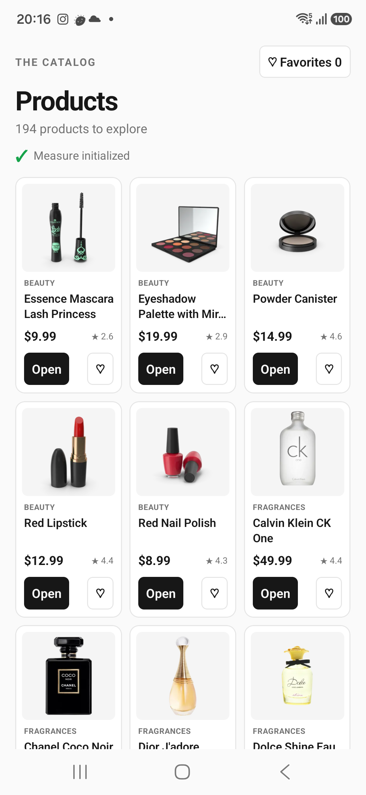
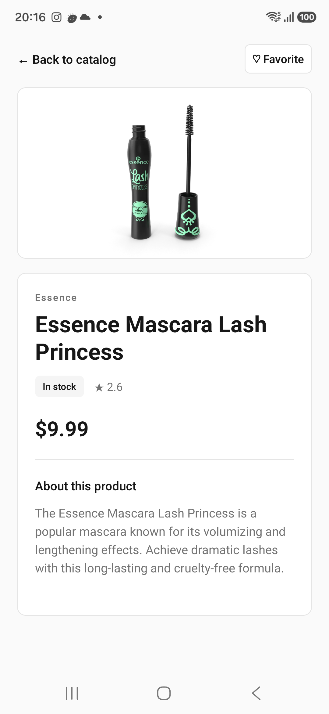
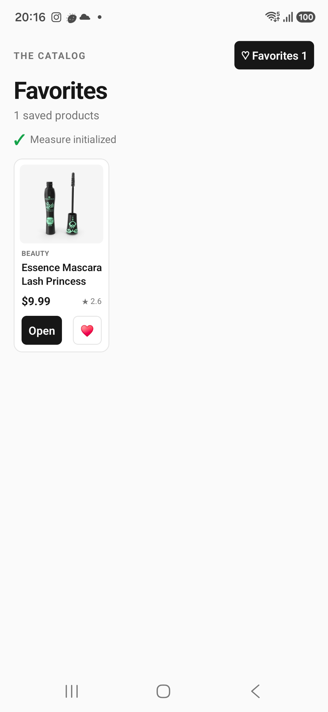

<div align="center">


<br />
<br />

# PerformanceLab React Native Benchmark App

### React Native catalog app instrumented with Measure for performance tests

A React Native 0.81.5 app that fetches live DummyJSON products, shows a three-column catalog and detail view, and records Measure spans and local PERFLAB logcat events to compare app architectures.

<br />

[![Built by Studio1](https://img.shields.io/badge/Built_by_Studio1-f97316?style=for-the-badge&logo=data%3Aimage%2Fsvg%2Bxml%3Bbase64%2CPHN2ZyB4bWxucz0iaHR0cDovL3d3dy53My5vcmcvMjAwMC9zdmciIHZpZXdCb3g9IjAgMCAxNjAgMTYwIiBmaWxsPSJub25lIj48cGF0aCBmaWxsLXJ1bGU9ImV2ZW5vZGQiIGNsaXAtcnVsZT0iZXZlbm9kZCIgZD0iTTAgMzVDMCAxNi42ODA3IDE0LjA3NDQgMS42NDg0NCAzMiAwLjEyNjk1M1YxNDFINTEuMDUyM0M1Mi40MzA4IDEzNy4zNDQgNTQuNzQ0NiAxMzMuNjg5IDU3Ljk5MzggMTMwLjAzM0M2MS4xNDQ2IDEyNi41MDggNjQuNjg5MiAxMjMuNDQgNjguNjI3NyAxMjAuODI5QzcyLjU2NjIgMTE4LjM0OSA3Ni4zNTY5IDExNi43ODIgODAgMTE2LjEyOVY4Ni43NTQ0Qzc1LjQ3MDggODcuOTI5MiA3MS4zODQ2IDg5LjY5MTkgNjcuNzQxNSA5Mi4wNDE1QzY0IDk0LjUyMjUgNjAuNzUwOCA5Ny40NiA1Ny45OTM4IDEwMC44NTRDNTYuNTM0NSAxMDIuNzIgNTUuMjU0NSAxMDQuNjU5IDU0LjE1MzkgMTA2LjY3MVYwSDEyNUMxNDQuMzMgMCAxNjAgMTUuNjY5OSAxNjAgMzVWMTI1QzE2MCAxNDQuMzMgMTQ0LjMzIDE2MCAxMjUgMTYwSDEyNFYxOEgxMDQuOTQ4QzEwMy41NjkgMjEuNjgxNiAxMDEuMjU1IDI1LjM2MjggOTguMDA2MiAyOS4wNDQ0Qzk0Ljg1NTQgMzIuNTk0MiA5MS4zMTA4IDM1LjY4NDEgODcuMzcyMyAzOC4zMTRDODMuNDMzOCA0MC44MTIgNzkuNjQzMSA0Mi4zODk2IDc2IDQzLjA0NzRWNzIuNjMwNEM4MC41MjkyIDcxLjQ0NzMgODQuNjE1NCA2OS42NzI0IDg4LjI1ODUgNjcuMzA1N0M5MiA2NC44MDc2IDk1LjI0OTIgNjEuODQ5MSA5OC4wMDYyIDU4LjQzMDdDOTkuNDY1NSA1Ni41NTEzIDEwMC43NDUgNTQuNTk4NiAxMDEuODQ2IDUyLjU3MjNWMTYwSDM1QzE1LjY3IDE2MCAwIDE0NC4zMyAwIDEyNVYzNVoiIGZpbGw9IiNmZmZmZmYiLz48L3N2Zz4K)](https://studio1hq.com)
[](https://measure.sh)

[Measure docs](https://measure.sh/docs) &nbsp;·&nbsp; [Measure](https://measure.sh) &nbsp;·&nbsp; [More examples](https://github.com/Studio1HQ) &nbsp;·&nbsp; [studio1hq.com](https://studio1hq.com)

</div>

<br />

## Overview

PerformanceLab is a React Native 0.81.5 app built to test and compare performance. It fetches the live [DummyJSON products collection](https://dummyjson.com/docs/products), shows compact product cards in a three-column `FlatList`, and opens a single-product detail view. The catalog shows product images, names, prices, ratings, descriptions, stock and a local favorite toggle.

A fixed header keeps the Favorites filter and the Measure initialization status visible. A connection error shows a retry control. The app is instrumented with [Measure](https://measure.sh) so the same interactions can be timed across builds.

Screenshots were captured on a Samsung SM-A175F with the current live-data app.

| Catalog | Product detail | Favorites |
| :---: | :---: | :---: |
|  |  |  |

## Features

- **Live catalog**: products load from DummyJSON into a three-column `FlatList`.
- **Product detail**: image, price, description and a fixed Favorite button.
- **Local favorites**: toggle favorites and filter the catalog to saved items.
- **Error handling**: a connection error shows a retry control.
- **Measure spans**: records `Catalog` and `Item Detail` screen views plus custom `catalog_to_detail` and `favorite_update` spans after JavaScript SDK initialization.
- **Local timing**: matching `PERFLAB` logcat events give a local duration for every Android interaction.
- **Architecture switch**: React Native 0.81 keeps the Legacy Architecture switch so builds can be compared.

## Tech stack

| Layer | Tool |
| --- | --- |
| Framework | [React Native](https://reactnative.dev) 0.81.5, React 19.1 |
| Language | TypeScript |
| Performance monitoring | [Measure](https://measure.sh) (`@measuresh/react-native`) |
| Data | [DummyJSON](https://dummyjson.com/docs/products) |
| Testing | Jest, ESLint |

## Getting started

### Prerequisites

- Node.js 20 or later
- The [React Native development environment](https://reactnative.dev/docs/set-up-your-environment) for Android, and for iOS on macOS (Ruby with Bundler and CocoaPods)
- A Measure API key from your Measure app

### Installation

```bash
git clone https://github.com/Studio1HQ/performance-lab.git
cd performance-lab
npm ci
```

### Environment variables

Copy `.env.example` to `.env` (Git-ignored) for Android. For iOS, copy `ios/Measure.local.xcconfig.example` to `ios/Measure.local.xcconfig` (also Git-ignored) and set `MEASURE_API_KEY` there.

| Variable | Description |
| --- | --- |
| `MEASURE_API_KEY` | API key from your Android or iOS Measure app. |
| `MEASURE_API_URL` | Measure ingest URL, `https://ingest.measure.sh` in the example file. |

### Run

Android:

```bash
npm run android
```

iOS, on macOS:

```bash
bundle install
bundle exec pod install --project-directory=ios
npm run ios
```

Local checks:

```bash
npm test -- --runInBand
npx tsc --noEmit
npm run lint
```

## How it works

`catalog_to_detail` measures from the Open handler to a callback after the detail layout. `favorite_update` measures from the toggle handler to a callback after the update. Neither marker proves visible pixels or a usable screen.

The October 2026 A/B/C benchmark CSVs were recorded before the live-data change, with a fixed 300-item catalog. They are historical results for that earlier UI and cannot be compared directly with this version. For a fresh architecture comparison, use the same API response and images across every build and rerun the trials.

React Native 0.81 retains the Legacy Architecture switch. React Native 0.82 and later run only the New Architecture.

## Resources

- [Measure](https://measure.sh): the performance monitoring product used for instrumentation.
- [React Native 0.82 release notes](https://reactnative.dev/blog/2025/10/08/react-native-0.82): the version boundary for the Legacy Architecture.
- [DummyJSON products API](https://dummyjson.com/docs/products): the data source.

<br />

---

<div align="center">

<a href="https://studio1hq.com">
  <picture>
    <source media="(prefers-color-scheme: dark)" srcset="https://raw.githubusercontent.com/Studio1HQ/website/main/brand/studio1-logo-on-dark.svg" />
    
  </picture>
</a>

Built by **[Studio1](https://studio1hq.com)**, the technical content and DevRel partner for devtool teams. Made with [Measure](https://measure.sh).<br />
Browse more open-source examples at [github.com/Studio1HQ](https://github.com/Studio1HQ).

[](https://studio1hq.com)
[](https://cal.com/studio1/collab)
[](https://x.com/Studio1HQ)
[](https://www.linkedin.com/company/studio1hq/)

<sub><a href="https://studio1hq.com">studio1hq.com</a> · Technical content, docs, video and DevRel for devtools</sub>

</div>
