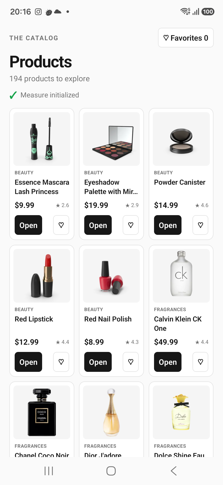
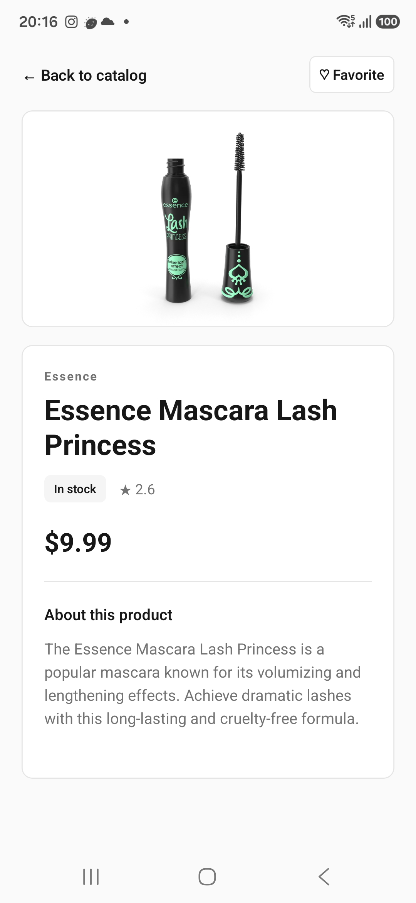
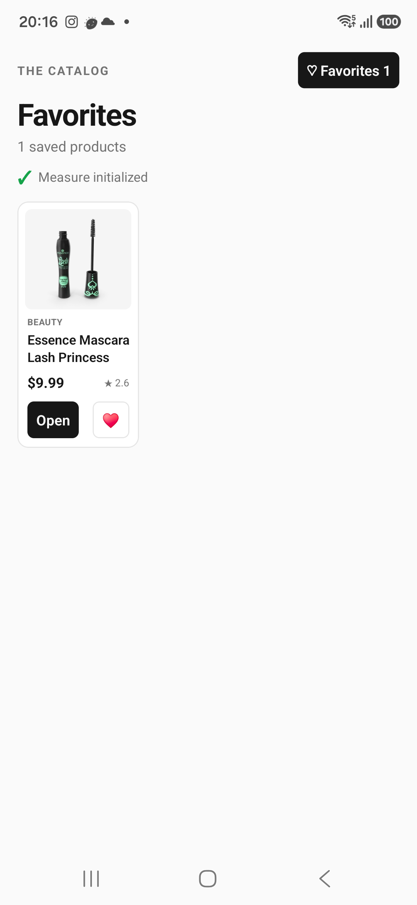

## PerformanceLab

This React Native 0.81.5 app fetches the live [DummyJSON products collection](https://dummyjson.com/docs/products), shows compact product cards in a three-column `FlatList`, and opens a single-product detail view. The catalog includes product images, names, prices, ratings, descriptions, stock, and a local favorite toggle. A fixed header keeps the Favorites filter and Measure initialization status visible. A connection error shows a retry control.

### Screenshots

Captured on a Samsung SM-A175F with the current live-data app.

| Catalog | Product detail | Favorites |
| :---: | :---: | :---: |
|  |  |  |

The October 2026 A/B/C benchmark CSVs were recorded before this change, with a fixed 300-item catalog. They are historical results for that earlier UI and cannot be reproduced or compared directly with this live-data version. For a fresh architecture comparison, use the same API response and images across every build and rerun the trials.

The app records Measure `Catalog` and `Item Detail` screen views and custom `catalog_to_detail` and `favorite_update` spans after JavaScript SDK initialization. Matching `PERFLAB` logcat events give a local duration for every Android interaction. `catalog_to_detail` measures the Open handler through a callback after detail layout; `favorite_update` measures the toggle handler through a callback after the update. Neither marker proves visible pixels or a usable screen.

### Setup

Install the React Native development prerequisites, then run `npm ci` in this directory.

For Android Measure collection, copy `.env.example` to `.env` and set `MEASURE_API_KEY`. For iOS, copy `ios/Measure.local.xcconfig.example` to `ios/Measure.local.xcconfig` and set `MEASURE_API_KEY`. Both credential files are Git-ignored.

Run `npm run android` for Android. On macOS, run `bundle install`, `bundle exec pod install --project-directory=ios`, then `npm run ios` for iOS.

### Local checks

```sh
npm test -- --runInBand
npx tsc --noEmit
npm run lint
```

React Native 0.81 retains the Legacy Architecture switch for comparison. React Native 0.82 and later run only the New Architecture. [React Native's version boundary](https://reactnative.dev/blog/2025/10/08/react-native-0.82).
